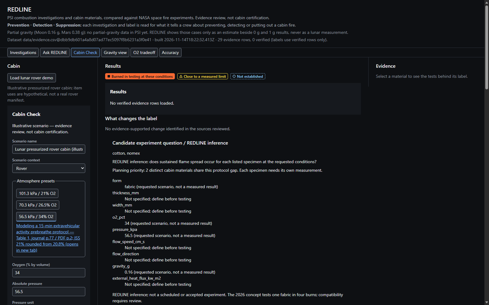
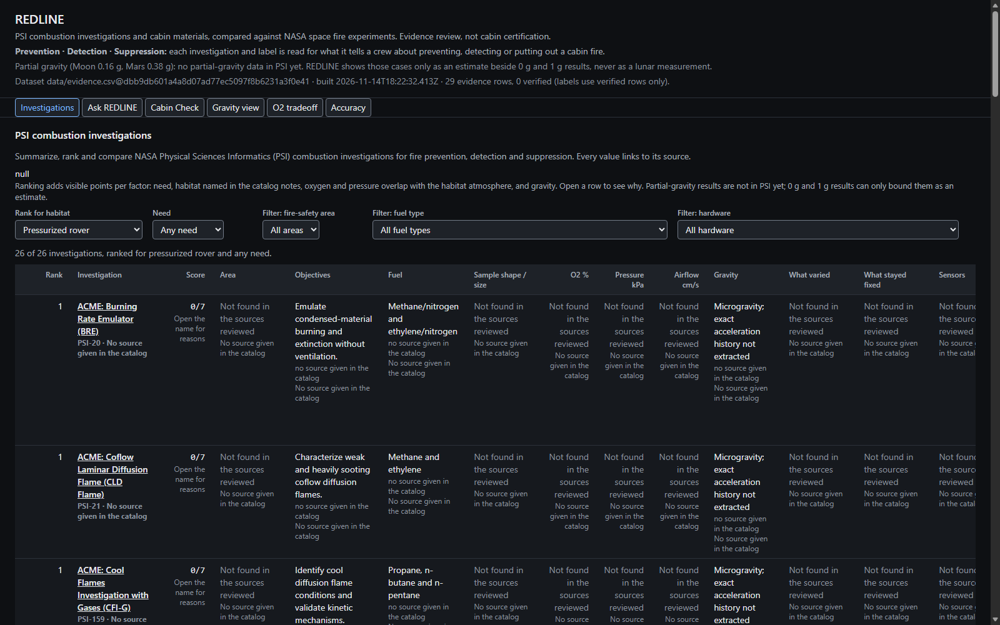
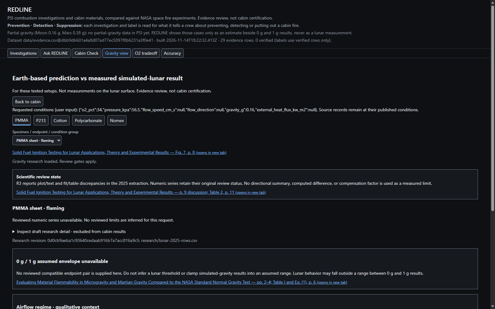
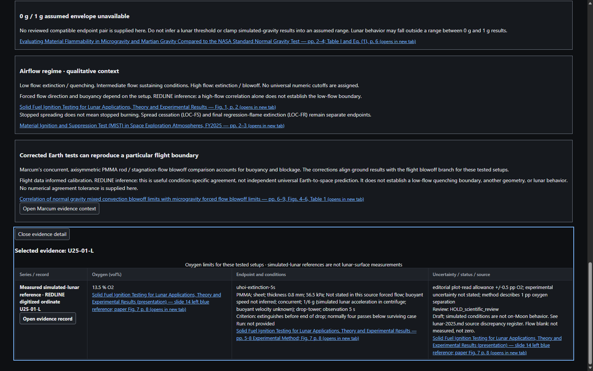
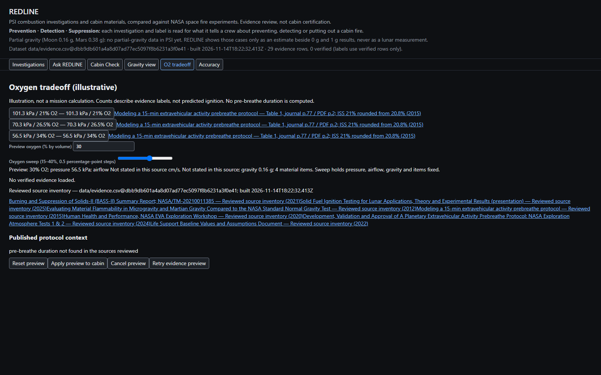

# REDLINE

**Live demo:** https://akarshsharma2012.github.io/REDLINE/

Built in under 30 hours at **NASA Space Apps Challenge 2026 (Seattle)**, Flame in Freefall challenge, by **The Embers**, three students from Interlake High School in Bellevue, WA.



## What it does

NASA plans to run a Moon base at around 30% oxygen or more, a level hospitals already treat as a fire risk. But cabin materials are still approved with a fire test done in Earth gravity. REDLINE checks whether that holds up.

Enter the materials in a Moon base or lunar rover (Nomex, cotton, Teflon, acrylic and more) with the cabin's oxygen, pressure and airflow. REDLINE compares each material against NASA's space fire experiments and labels it **burned in testing at these conditions**, **close to a measured limit**, or **not found in the sources reviewed**, with a link to the experiment behind every label.

- Oxygen slider: the tradeoff between spacewalk pre-breathe time and how many materials become a fire risk.
- Fixes: swap a material or cap the oxygen level.
- Every untested combination becomes a suggested experiment for NASA's upcoming Moon fire tests.

The evidence set has 45 data points from 10 NASA and peer-reviewed sources (Saffire, BASS-II and related work), each checked against its source. See `research/verification-report.md`.

## Who we are

The Embers is a three-person student team: **Akarsh Sharma, Lakshya Khandelwal and Achintya Akula**, Interlake High School, Bellevue, WA.

We build fast. REDLINE went from blank repo to a working, sourced tool in one hackathon weekend, using AI coding agents in parallel with a human-checked evidence pipeline. We want to do that at as many hackathons and student competitions as we can this season.

## Support the team

We are looking for sponsors and partners for our 2026–27 hackathon season. What helps most:

- **API and cloud credits** (LLM APIs, hosting, GPUs) so we can build at full speed during events.
- **Tool access** (dev tools, design tools, AI coding tools).
- **Small grants** for registration, travel to in-person events and hardware.
- **Mentorship** from engineers in aerospace, AI or the field a challenge is about.

What sponsors get: your logo and a thank-you in this README and every project we ship this season, mentions in our demos and write-ups, and honest feedback on your product from heavy student users.

**Contact:** The Embers, Interlake High School, Bellevue, WA
Parent contact: meenasharma17@gmail.com

### Our sponsors

Your name could be here.

## Screenshots

| | |
|---|---|
|  |  |
|  |  |

## Run locally

No install step and no dependencies. Needs Python 3 (any recent version) and Node 22.12 or newer.

```sh
python -m http.server 8000     # from the repo root, then open http://localhost:8000/
npm test                       # or: node --test
```

Open the page through the server, not as a `file://` path: browsers block ES modules loaded from `file://`.
`data/evidence.json` is built by `scripts/build-evidence.mjs`.

Work is tracked in GitHub Issues; see `AGENTS.md` for how agents pick up tasks.
